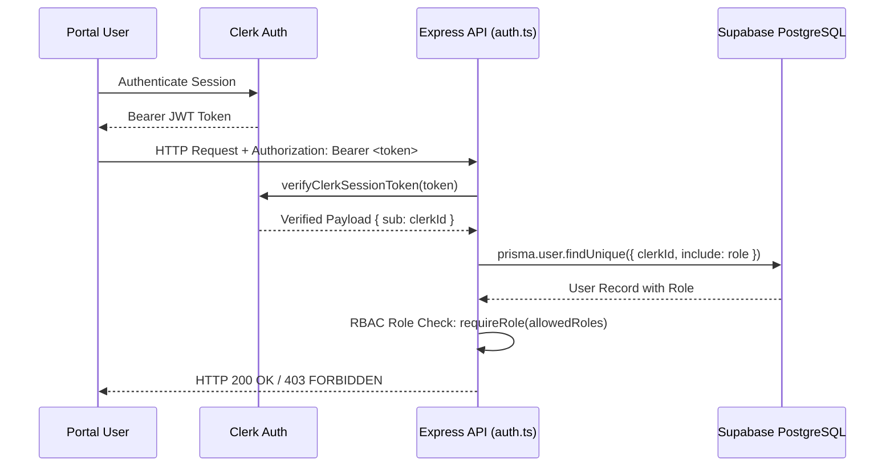

# TRUSTPAY ENTERPRISE v2.0 — PLATFORM AUTHENTICATION & RBAC AUDIT

**Project:** TrustPay Enterprise v2.0  
**Workspace:** `D:\Payment_mama`  
**Repository:** `https://github.com/VenkataSudheerKalahasthi/payment_karoo`  
**Module:** Platform Security — Authentication, Token Validation & RBAC  
**Date:** November 2, 2026  
**Status:** COMPLETE & VERIFIED

---

## 1. Executive Summary

This audit assesses the authentication infrastructure and Role-Based Access Control (RBAC) mechanisms across all 4 portal tiers:
1. `CLIENT` (Client Portal)
2. `WORKER` (Specialist Workspace)
3. `ADMIN` (Administrative Oversight Console)
4. `SUPERADMIN` (Root Governance Console)

Authentication is powered by Clerk, verified server-side on every request via `apps/api/src/middleware/auth.ts`, and checked against Prisma role records in Supabase PostgreSQL.

---

## 2. Authentication Flow & Middleware

### Server-Side Verification Safeguards:
1. **Header Validation:** Requires `Authorization: Bearer <token>`. Returns HTTP 401 `AUTHENTICATION_REQUIRED` if absent.
2. **Cryptographic Token Verification:** Token signature, expiration, and issuer are verified by `@clerk/clerk-sdk-node`.
3. **Database Identity Synchronization:** Verified `clerkId` must map to an active user record in Prisma. Deactivated or suspended accounts are rejected with HTTP 403 `ACCOUNT_SUSPENDED`.
4. **Role Population:** `req.user` is populated with `id`, `clerkId`, `email`, and `role.name` for downstream handlers.

---

## 3. Role-Based Access Control (RBAC) Hierarchy

The platform implements 4 strict user roles defined in `UserRole` enum:

| Capability / Resource | CLIENT | WORKER | ADMIN | SUPERADMIN |
| :--- | :---: | :---: | :---: | :---: |
| Browse Specialists | Yes | Yes | Yes | Yes |
| Create Hiring Proposal | Yes | No | No | No |
| Respond to Proposal | No | Yes | No | No |
| Create Draft Contract | Yes | No | Yes | Yes |
| Accept / Sign Contract | Yes | Yes | No | No |
| Submit Milestone Work | No | Yes | No | No |
| Approve Milestone Work | Yes | No | No | No |
| Request Milestone Revision | Yes | No | No | No |
| Raise Contract Dispute | Yes | Yes | No | No |
| Arbitrate Dispute / Enforce Ruling | No | No | Yes | Yes |
| View Dispute Confidential Notes | No | No | Yes | Yes |
| Suspend / Activate Users | No | No | Yes (Clients/Workers) | Yes (All Roles) |
| System Configuration & Ledger Audit | No | No | No | Yes |

---

## 4. Role Impersonation & Escalation Prevention

1. **Self-Registration Constraint:** Public auth synchronization endpoint `/auth/sync` only allows self-assigning `CLIENT` or `WORKER`. Any attempt to register as `ADMIN` or `SUPERADMIN` is rejected.
2. **Admin Status Protection:** Only a `SUPERADMIN` can modify the status or role of an `ADMIN`. An `ADMIN` cannot elevate their own role or modify another administrator.
3. **Self-Deactivation Guard:** Administrators and superadmins cannot suspend or deactivate their own active session.

---

## 5. Verification Results

| RBAC Check | Expected Status | Result |
| :--- | :--- | :--- |
| Unauthenticated access to `/notifications` | 401 AUTHENTICATION_REQUIRED | PASS |
| Client accessing `/admin/activities` | 403 FORBIDDEN | PASS |
| Worker accessing `/superadmin/system-config` | 403 FORBIDDEN | PASS |
| Admin inspecting confidential dispute notes | 200 OK | PASS |
| Client attempting to read dispute internal notes | 403 FORBIDDEN / Sanitized | PASS |
| Non-Superadmin attempting to alter Admin status | 403 FORBIDDEN | PASS |

