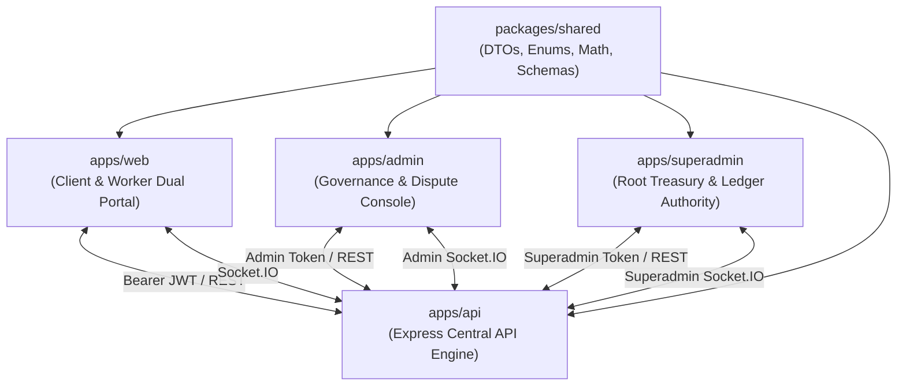

# TrustPay Enterprise v2.0 — Master UI/UX Design System & Monorepo Audit Specification
**Document ID:** `TP-DS-MASTER-v2.0-LOCKED`  
**Status:** **OFFICIALLY LOCKED & VERIFIED**  
**Design Style:** Black + Neon Lime Green Premium Fintech SaaS Design (Institutional Legal & Cryptographic Escrow)  
**Stack Alignment:** React 18/19, Vite, Tailwind CSS 3.4, Framer Motion, Three.js 0.173, Recharts, Lucide React, Clerk SDK  
**Accessibility Target:** WCAG 2.2 Level AA / AAA Compliant  
**Governing Scope:** All 4 Web Portals (`apps/web`, `apps/admin`, `apps/superadmin`), Shared Contracts (`packages/shared`), and API Interoperability (`apps/api`)  

---

## 1. Official Locked Global Themes & Design Tokens

TrustPay Enterprise v2.0 enforces dual-theme visual standards across all portals and applications, with Dark Theme (Obsidian Chrome) as the default and Light Theme (Pearl White + Royal Blue) as the alternative.

### 1.1 Dual Theme Palette Specifications

```css
/* ==========================================================================
   DARK THEME — OBSIDIAN CHROME (DEFAULT)
   ========================================================================== */
:root, html.dark {
  --tp-bg-main: #080808;                      /* Base Background */
  --tp-bg-sidebar: #080808;                   /* Persistent Left Sidebar */
  --tp-bg-card: #171717;                      /* Standard Card Surface */
  --tp-bg-elevated: #202020;                  /* Elevated Card / Modal Surface */
  --tp-bg-hover: #303030;                     /* Interactive Hover State */
  
  --tp-text-primary: #CDCBCA;                 /* Primary Editorial Text */
  --tp-text-secondary: #A5A5A5;               /* Secondary Metadata Text */
  --tp-text-muted: #777777;                   /* Muted Labels & Placeholders */
  
  --tp-border: rgba(205, 203, 202, 0.18);     /* Translucent Hairline Border */
  --tp-border-strong: rgba(205, 203, 202, 0.35);

  --tp-brand-primary: #CDCBCA;                /* Obsidian Chrome Accent */
  --tp-brand-hover: #FFFFFF;
}

/* ==========================================================================
   LIGHT THEME — PEARL WHITE + ROYAL BLUE (ALTERNATIVE)
   ========================================================================== */
html:not(.dark), html.light {
  --tp-bg-main: #F5F7FA;                      /* Pearl White Canvas */
  --tp-bg-sidebar: #FFFFFF;                   /* Crisp White Sidebar */
  --tp-bg-card: #FFFFFF;                      /* White Card Surface */
  --tp-bg-elevated: #F1F5F9;                  /* Slate-50 Elevated Surface */
  --tp-bg-hover: #EFF6FF;                     /* Soft Blue-50 Hover State */
  
  --tp-text-primary: #242424;                 /* High-Contrast Charcoal Text */
  --tp-text-secondary: #475569;               /* Slate-600 Secondary Text */
  --tp-text-muted: #64748B;                   /* Slate-500 Muted Text */
  
  --tp-border: #E2E8F0;                       /* Crisp Slate-200 Border */
  --tp-border-strong: #CBD5E1;

  --tp-brand-primary: #2563EB;                /* Royal Blue Primary */
  --tp-brand-hover: #1D4ED8;                  /* Deep Royal Blue Hover */
  --tp-brand-soft: #DBEAFE;                   /* Soft Blue Tint */
}
```

### 1.2 Theme System Rules
1. **Default Theme:** Dark (Obsidian Chrome).
2. **Alternative Theme:** Light (Pearl White + Royal Blue).
3. **Theme Switching:** Global header toggle (`<ThemeToggle />`) mounted in all four portal header bars.
4. **Theme Preference:** Persisted strictly in `localStorage` (`trustpay_theme: "dark" | "light"`) across browser sessions.
5. **Emerald, Amber, and Red:** Exclusively reserved for semantic financial status indicators. They must never be repurposed as general brand or decorative colors.
6. **Typography:** Inter (Body & Headers) + JetBrains Mono (Financials & Cryptographic hashes).

### 1.3 Semantic Financial Status Tokens (Strictly Reserved)
Emerald, Amber, and Red are strictly isolated for financial, cryptographic, and dispute operational states:

| Financial Semantic State | Dark Mode (Obsidian) | Light Mode (Pearl) | Applied Scenarios |
| :--- | :--- | :--- | :--- |
| **Escrow Active / Settled** | Text: `#10B981`<br>Bg: `rgba(16,185,129,0.12)`<br>Border: `rgba(16,185,129,0.25)` | Text: `#059669`<br>Bg: `#ECFDF5`<br>Border: `#A7F3D0` | `ESCROW_FUNDED`, `MILESTONE_APPROVED`, `SETTLED`, `SUCCEEDED`, `HEALTHY` |
| **Dispute Hold / In Revision**| Text: `#F59E0B`<br>Bg: `rgba(245,158,11,0.12)`<br>Border: `rgba(245,158,11,0.30)` | Text: `#D97706`<br>Bg: `#FFFBEB`<br>Border: `#FDE68A` | `DISPUTE_HOLD`, `IN_REVISION`, `PENDING_REVIEW`, `AMENDMENT_PROPOSED` |
| **Critical / Terminated** | Text: `#EF4444`<br>Bg: `rgba(239,68,68,0.12)`<br>Border: `rgba(239,68,68,0.30)` | Text: `#DC2626`<br>Bg: `#FEF2F2`<br>Border: `#FECACA` | `FAILED`, `CANCELLED`, `TERMINATED`, `REVERSED`, `SUSPENDED` |

### 1.4 Typography & Font Standards
- **Primary Interface & Editorial Sans:** `Inter` (Font weight 400, 500, 600, 700; letter-spacing `-0.015em` to `-0.025em` on headlines).
- **Financial & Cryptographic Monospace:** `JetBrains Mono` with `font-mono tabular-nums` strictly enforced on:
  - All minor-unit currency amounts (`$1,499.95`, `149995n`)
  - Canonical SHA-256 contract hashes (`392547458ca6...`)
  - Double-entry ledger accounts (`1000-CASH-ESCROW`, `2100-CLIENT-LIABILITY`)
  - Transaction reference UUIDs and timestamps.

---

## 2. Complete Monorepo Project Architecture Audit (Part 2)



### 2.1 `apps/web` (Client & Specialist Portal)
- **Port:** `3000` | **Build:** Vite 6.1.1, React 18.3.1, TypeScript 5.7.3.
- **State Store:** Redux Toolkit (`authSlice.ts`, `systemSlice.ts`) + Local React States.
- **Routing:** Path `/` drives tab switching via `App.tsx` state machine (`dashboard`, `marketplace`, `contracts`, `projects`, `hiring`, `shortlist`, `wallet`, `profile`, `system`), with sub-route `/payment/callback` handled by `PaymentCallbackPage.tsx`.
- **Identity:** Clerk React SDK (`@clerk/clerk-react`) with custom JWT interceptor dynamically bound in `services/api.ts` via `setAuthTokenGetter()`.
- **3D Graphics:** Three.js (`three@0.173.0`) in `ThreeEscrowVisual.tsx` rendering dual wireframe icosahedrons with ambient lighting.
- **Components Discovered (17 files):**
  - `DashboardOverview.tsx`: Client & Worker KPI metrics, quick actions.
  - `WorkerMarketplace.tsx`: Specialist directory, search query, skill filters, shortlist toggles.
  - `ShortlistPage.tsx`: Bookmarked specialist collection with direct hiring triggers.
  - `CreateHiringRequestModal.tsx`: Proposal creator (scope, milestones, budget, deadline).
  - `HiringRequestsList.tsx`: Tabular incoming/outgoing proposals with status badges.
  - `CreateContractModal.tsx`: Direct contract drafting wizard.
  - `ContractList.tsx`: Contract cards with status pills and actions.
  - `ContractDetailModal.tsx`: Split-screen reader, digital signature, SHA-256 seal.
  - `ContractLifecyclePanel.tsx`: Contract stage timeline and progression bar.
  - `ProjectsWorkspace.tsx`: Deliverable submission dropzone, revision review, milestone settle.
  - `ClientWallet.tsx`: 4 KPI balance cards, escrow contract breakdowns, refund modal.
  - `SpecialistWallet.tsx`: 5 KPI earnings cards, 10% fee transparency, settlement history.
  - `ProfileManagement.tsx`: Client profile editing & specialist taxonomy skills/portfolio.
  - `NotificationDropdown.tsx`: Real-time notification popover with unread counter.
  - `ThreeEscrowVisual.tsx`: 3D WebGL escrow simulation.
  - `ClerkConfigNotice.tsx`: Development key indicator banner.
  - `ErrorBoundary.tsx`: Runtime exception containment wrapper.

### 2.2 `apps/admin` (Governance & Dispute Portal)
- **Port:** `3001` | **Build:** Vite 6.1.1, React 18.3.1, TypeScript 5.7.3.
- **Authentication:** Clerk React SDK enforcing `ADMIN` or `SUPERADMIN` role clearances.
- **Real-Time Channel:** Socket.IO client in `services/socket.ts` connected to `/admin` namespace.
- **Components Discovered (6 files):**
  - `App.tsx`: Unified shell containing Global Metrics tab, User Directory with search/role filters, User Inspection modal, Status Control modal (Suspend/Activate), and Activities Audit history.
  - `AdminContractsOversight.tsx`: Global contract monitoring table with live filters.
  - `DisputesWorkspace.tsx`: Dispute resolution workspace with evidence PDF preview, claims timeline, and split-settlement resolution enforcement.
  - `NotificationDropdown.tsx`: Administrative alert feed.
  - `ClerkConfigNotice.tsx`: Configuration notice.
  - `ErrorBoundary.tsx`: Runtime crash shield.

### 2.3 `apps/superadmin` (Root Governance, Treasury & Security Portal)
- **Port:** `3002` | **Build:** Vite 6.1.1, React 18.3.1, TypeScript 5.7.3.
- **Authentication:** Clerk React SDK strictly restricted to `SUPERADMIN` accounts.
- **Real-Time Channel:** Socket.IO client in `services/socket.ts` connected to `/superadmin` namespace.
- **Components Discovered (6 files):**
  - `App.tsx`: Root administrative console governing Root Telemetry tab, Role Provisioning matrix, Contract Integrity audit, Double-Entry General Ledger journal table, Offsetting Reversal modal, Trial Balance report ($\Delta = 0$), Financial Config tab, and Security Audit Log explorer.
  - `SuperadminDisputesGovernance.tsx`: High-tier dispute escalation and legal enforcement interface.
  - `NotificationDropdown.tsx`: Root governance alert feed.
  - `ClerkConfigNotice.tsx`: Root configuration banner.
  - `ErrorBoundary.tsx`: Exception containment shield.

### 2.4 `apps/api` (Central Backend Engine — Interoperability Audit)
- **Port:** `5000` | **Runtime:** Node.js, Express, Prisma ORM, Supabase PostgreSQL pooler.
- **Endpoint Surface:** 108 REST endpoints across 21 modules (`contracts`, `workers`, `shortlists`, `hiring-requests`, `disputes`, `escrow`, `payments`, `ledger`, `audit-logs`, `notifications`, `storage`, `webhooks`, `health`, etc.).
- **Security:** Fail-closed bearer JWT auth middleware, resource ownership IDOR verification, and rate limiting (`100 req/min`).
- **Safety Posture:** All live money movements deactivated (`isLiveMoneyDisabled = true`, `PAYMENTS_LIVE_ENABLED = false`). *Do not alter backend code.*

### 2.5 `packages/shared` (Universal Types & Mathematical Contracts)
- **Build:** Pure TypeScript, zero external UI dependencies.
- **Financial Precision:** `majorToMinor(amount, currency)` and `minorToMajor(amountMinor, currency)` providing exact 64-bit integer minor unit arithmetic (`bigint`), eliminating floating-point rounding errors.
- **Contract Integrity:** `computeCanonicalContractHash()` generating deterministic SHA-256 digests across contract title, scope, parties, and milestone allocations.

---

## 3. Complete UI/UX Inventory & Component Audit (Part 3)

### 3.1 Portal-by-Portal Technical & UX Audit Matrix

| Portal / Module | Screen / View | Existing Condition | Components Requiring Redesign | Key Functionality | API Dependencies | Auth / Role Gate | Responsive Issues Observed | Implementation Risks |
| :--- | :--- | :--- | :--- | :--- | :--- | :--- | :--- | :--- |
| **`apps/web`** (Landing) | Public View (`App.tsx`) | Functional, uses legacy `#020617` background | Hero section, Value cards, CTA buttons, Three.js container | Path selection (Client vs Specialist), live cluster ping | `GET /api/v1/health` | Public (Unauthenticated) | Hero button wrap on $<400\text{px}$ viewports | WebGL canvas context loss if unmounted rapidly |
| **`apps/web`** (Client) | Dashboard (`DashboardOverview.tsx`) | Standard slate cards, mixed badge heights | Metric KPI tiles, Quick action buttons, Recent items | 4 KPI cards, navigation dispatch, contract shortcuts | `GET /dashboard/metrics` | `CLIENT` | 4-col KPI cards overflow on tablet ($768\text{px}$) | Non-tabular figures jitter during metric refresh |
| **`apps/web`** (Client) | Marketplace (`WorkerMarketplace.tsx`) | Search input and filter tags functional | Specialist cards, Taxonomy skill chips, Hire modal | Full-text worker search, rate range, shortlist toggle | `GET /workers`, `POST/DEL /shortlists` | `CLIENT` | Filter chips wrap awkwardly on mobile ($375\text{px}$) | Missing empty state illustration when 0 results |
| **`apps/web`** (Client) | Contract Drafting (`CreateContractModal.tsx`) | Modal functional but text inputs lack unified focus rings | Form fields, Milestone builder rows, Total budget sum | Add/remove milestone rows, budget validation | `POST /contracts` | `CLIENT` | Sticky modal footer covers inputs on small screens | Floating-point rounding if minor units not formatted |
| **`apps/web`** (Client) | Contract Viewer (`ContractDetailModal.tsx`) | Split view works; signature block plain | SOW reader pane, Signature certification box, SHA-256 pill | Digital acceptance, PDF download, integrity check | `POST /contracts/:id/accept`, `GET /:id/pdf` | `CLIENT` or `WORKER` | Legal text exceeds $100\text{ch}$ on wide desktop | Stale PDF download token if session expires |
| **`apps/web`** (Client) | Projects (`ProjectsWorkspace.tsx`) | Deliverables table functional; settlement button plain | Project progress bar, Deliverable review drawer, Settle CTA | Review deliverable files, request revision, settle | `POST /revisions`, `POST /settlements/:mId` | `CLIENT` | Nested timeline cramped on tablet viewports | Settle button must have dual-confirmation modal |
| **`apps/web`** (Client) | Wallet (`ClientWallet.tsx`) | 4 KPI cards, contracts list; lacks theme tokens | Balance KPI cards, Escrow breakdown table, Refund modal | Inspect active escrow, request unallocated refund | `GET /payments/wallet`, `POST /payments/refunds` | `CLIENT` | Financial table scrolls horizontally on mobile | Overdraft calculation error if ledger lags |
| **`apps/web`** (Worker) | Specialist Wallet (`SpecialistWallet.tsx`) | 5 KPI cards; 10% commission banner plain | Earnings cards, Fee deduction bar, Ledger history | View settled net, platform commission, transaction list | `GET /payments/wallet` | `WORKER` | Transaction table overflows card on mobile | Discrepancy if ledger metadata lacks commission |
| **`apps/web`** (Worker) | Submissions (`ProjectsWorkspace.tsx`) | File input raw; status pills lack locked theme | Deliverable upload dropzone, Revision notes field | Submit milestone deliverable, attach evidence URLs | `POST /submissions` | `WORKER` | Drag-and-drop dropzone lacks mobile touch state | Uploading disallowed MIME types rejected by API |
| **`apps/web`** (Worker) | Profile (`ProfileManagement.tsx`) | Basic form; taxonomy chip manager plain | Skills selector, Portfolio card grid, Rate input | Update bio, add verified skills, set hourly rate | `PUT /profiles/me`, `POST/DEL /workers/me/skills`| `WORKER` | Skill tag cloud wraps unevenly on mobile | Rate input must enforce currency bounds |
| **`apps/admin`** | Dashboard (`App.tsx`) | Functional metrics; high-contrast borders missing | Global stats cards, Activity feed list, Server telemetry | System-wide statistics, active dispute count | `GET /admin/dashboard`, `GET /admin/activities` | `ADMIN` / `SUPERADMIN` | Metric tiles wrap unevenly on tablet | Metric polling must not spam API gateway |
| **`apps/admin`** | User Directory (`App.tsx`) | Functional search/filter table; modal plain | User table, Inspect modal, Status change drawer | Search users, inspect profiles, suspend/activate | `GET /users`, `PATCH /users/:id/status` | `ADMIN` / `SUPERADMIN` | Table cells truncate email addresses on mobile | Audit reason must be mandatory for suspension |
| **`apps/admin`** | Disputes (`DisputesWorkspace.tsx`) | Functional split-screen; resolution form plain | Claims timeline, Evidence viewer, Split settlement form | Inspect claims, review PDF evidence, enforce split | `GET /disputes`, `POST /resolutions/enforce` | `ADMIN` / `SUPERADMIN` | Split allocation sliders cramped on small screens | Allocations must exactly equal claimed minor units |
| **`apps/superadmin`** | Root Telemetry (`App.tsx`) | Dense text layout; lacks visual hierarchy | Host telemetry cards, Security status indicators | Real-time system monitoring, DB latency | `GET /admin/dashboard`, `/health/database` | `SUPERADMIN` | Telemetry grid breaks on $<1024\text{px}$ viewports | High-frequency polling risk if left unmounted |
| **`apps/superadmin`** | Ledger (`App.tsx`) | Functional table; numbers not right-aligned | Double-entry journal table, Debit/Credit badges | Inspect all posted ledger transactions | `GET /ledger/transactions`, `GET /trial-balance` | `SUPERADMIN` | Multi-column table scrolls off-screen on mobile | Debits and credits must be aligned to right edge |
| **`apps/superadmin`** | Reversals (`App.tsx`) | Raw modal dialog; lacks destructive warning | Offsetting reversal modal, Legal reason field | Execute immutable reversing ledger journal | `POST /ledger/transactions/:ref/reverse` | `SUPERADMIN` | Confirmation button triggers on accidental enter | Reversing already reversed transaction returns 409 |
| **`apps/superadmin`** | Roles (`App.tsx`) | Table with dropdown; permission matrix plain | Role elevation table, Permission catalog drawer | Promote/demote user roles (Admin, Superadmin) | `POST /admin/provision-role` | `SUPERADMIN` | Permissions matrix overflows screen width | Self-demotion must be blocked to prevent lockout |

---

## 4. Sequential 8-Phase Implementation Roadmap (Part 4)

```mermaid
gantt
    title TrustPay Enterprise v2.0 — Sequential Implementation Roadmap
    dateFormat  X
    axisFormat  Phase %X
    section UI Redesign
    Phase 1: Client Portal             :p1, 0, 1
    Phase 2: Worker Portal             :p2, 1, 2
    Phase 3: Admin Portal              :p3, 2, 3
    Phase 4: Super Admin Portal        :p4, 3, 4
    Phase 5: Public Landing Page       :p5, 4, 5
    Phase 6: Clerk Auth UI             :p6, 5, 6
    section Global Systems
    Phase 7: Global Theme Integration  :p7, 6, 7
    Phase 8: Responsive & Regression   :p8, 7, 8
```



### Phase 1: Client Portal Redesign (`apps/web`)
- **Objective:** Elevate Client Portal to official Obsidian Chrome / Pearl White theme, standardizing SOW reader, milestone creation, and escrow wallet.
- **Proposed Files to Modify:**
  1. `apps/web/src/components/DashboardOverview.tsx` (Adopt locked KPI card tokens, tabular figures)
  2. `apps/web/src/components/WorkerMarketplace.tsx` (Refined specialist cards, skill tags, filter pills)
  3. `apps/web/src/components/ShortlistPage.tsx` (Standardized empty states, quick-action cards)
  4. `apps/web/src/components/CreateHiringRequestModal.tsx` (Architectural inputs, currency validation)
  5. `apps/web/src/components/HiringRequestsList.tsx` (Tabular layout, status pills, proposal badges)
  6. `apps/web/src/components/CreateContractModal.tsx` (Multi-step milestone creator, minor unit formatting)
  7. `apps/web/src/components/ContractList.tsx` (Contract cards, status badges, PDF download triggers)
  8. `apps/web/src/components/ContractDetailModal.tsx` (Split-screen SOW reader, $\le 68\text{ch}$ line-height, SHA-256 seal)
  9. `apps/web/src/components/ClientWallet.tsx` (4 KPI cards, escrow contract breakdowns, refund modal)
- **Key Risks & Dependencies:** Ensure `ClientWallet.tsx` minor-unit math matches `packages/shared`; ensure modal focus trap does not trap background screen reader focus.

### Phase 2: Worker (Specialist) Portal Redesign (`apps/web`)
- **Objective:** Implement unified specialist earnings transparency, deliverable submissions dropzone, and taxonomy skill management.
- **Proposed Files to Modify:**
  1. `apps/web/src/components/SpecialistWallet.tsx` (5 KPI earnings cards, 10% commission bar, double-entry settlement history)
  2. `apps/web/src/components/ProjectsWorkspace.tsx` (Deliverable submission dropzone, revision review drawer, settlement trigger)
  3. `apps/web/src/components/ProfileManagement.tsx` (Specialist taxonomy skills cloud, portfolio gallery, rate bounds)
- **Key Risks & Dependencies:** File dropzone must strictly validate MIME types and bucket limits prior to upload request.

### Phase 3: Admin Portal Redesign (`apps/admin`)
- **Objective:** Redesign operational governance dashboard, user directory controls, contract oversight, and dispute split-settlement interface.
- **Proposed Files to Modify:**
  1. `apps/admin/src/App.tsx` (Global metrics, user directory table, inspect modal, status control drawer, activity history)
  2. `apps/admin/src/components/AdminContractsOversight.tsx` (Global contracts monitoring table, status filters)
  3. `apps/admin/src/components/DisputesWorkspace.tsx` (Dispute timeline, PDF evidence viewer, split-settlement sliders)
  4. `apps/admin/src/components/NotificationDropdown.tsx` (Admin notification popover)
- **Key Risks & Dependencies:** Dispute split-settlement form must validate that Client Amount + Worker Amount exactly equals Claimed Minor Units.

### Phase 4: Super Admin Portal Redesign (`apps/superadmin`)
- **Objective:** Redesign root governance console, role provisioning matrix, double-entry ledger explorer, transaction reversal modal, and trial balance.
- **Proposed Files to Modify:**
  1. `apps/superadmin/src/App.tsx` (Root telemetry, role elevation table, ledger journal, reversal modal, trial balance, audit logs)
  2. `apps/superadmin/src/components/SuperadminDisputesGovernance.tsx` (Escalated dispute arbitration interface)
  3. `apps/superadmin/src/components/NotificationDropdown.tsx` (Root security notification popover)
- **Key Risks & Dependencies:** Prevent self-demotion in role provisioning matrix; format ledger debits and credits with strict right-alignment.

### Phase 5: Public Landing Page Redesign (`apps/web`)
- **Objective:** Elevate unauthenticated landing page with hero typography, trust signals, dual role cards, and 3D WebGL escrow visualizer.
- **Proposed Files to Modify:**
  1. `apps/web/src/App.tsx` (Landing page hero, institutional trust badges, role routing cards, feature showcase)
  2. `apps/web/src/components/ThreeEscrowVisual.tsx` (Adopt WebGLRenderer singleton, DPR cap $\le 2$, ResizeObserver, `prefers-reduced-motion`)
- **Key Risks & Dependencies:** Ensure Three.js canvas resizes accurately inside responsive CSS containers without WebGL context loss.

### Phase 6: Clerk Authentication UI Redesign
- **Objective:** Style Clerk modals, sign-in gates, and role selection modal to blend seamlessly with Obsidian Chrome and Pearl White themes.
- **Proposed Files to Modify:**
  1. `apps/web/src/App.tsx` (Role selection modal for new users, Clerk sign-in banner styling)
  2. `apps/admin/src/App.tsx` (Administrative sign-in gate card)
  3. `apps/superadmin/src/App.tsx` (Root clearance sign-in gate card)
  4. `apps/web/src/components/ClerkConfigNotice.tsx` (Consistent enterprise notice badge)
  5. `apps/admin/src/components/ClerkConfigNotice.tsx`
  6. `apps/superadmin/src/components/ClerkConfigNotice.tsx`
- **Key Risks & Dependencies:** Do not bypass or alter Clerk authentication flows or token retrieval hooks.

### Phase 7: Global Theme Integration (`apps/web`, `apps/admin`, `apps/superadmin`)
- **Objective:** Wire unified CSS variables and dark/light mode toggle across all three applications.
- **Proposed Files to Modify:**
  1. `apps/web/src/index.css` (Inject locked `:root` and `[data-theme="light"]` variables)
  2. `apps/admin/src/index.css` (Inject locked `:root` and `[data-theme="light"]` variables)
  3. `apps/superadmin/src/index.css` (Inject locked `:root` and `[data-theme="light"]` variables)
  4. `apps/web/src/App.tsx` (Add subtle theme toggle button in header)
  5. `apps/admin/src/App.tsx` (Add subtle theme toggle button in header)
  6. `apps/superadmin/src/App.tsx` (Add subtle theme toggle button in header)
- **Key Risks & Dependencies:** Verify zero layout shift between theme switches.

### Phase 8: Complete Responsive & Regression Testing
- **Objective:** Conduct complete cross-browser, multi-viewport (375px, 768px, 1024px, 1440px), and automated regression testing.
- **Proposed Test Actions:**
  1. Execute automated test suites (`npm test` — all 18 files, 295 tests).
  2. Run Headless Chromium automation across Desktop, Tablet, and Mobile viewports.
  3. Inspect console logs for zero runtime errors or unhandled exceptions.
  4. Verify WCAG 2.2 AA contrast ratios and keyboard tab navigation.

---

## 5. Strict Preservation & Safety Mandates

1. **Backend Code Immutable:** Do not modify any file in `apps/api/` or `prisma/`. All API routes, controllers, services, and middlewares remain unchanged.
2. **Clerk Authentication Immutable:** Preserve Clerk SDK hooks (`useAuth`, `useUser`, `UserButton`, `SignInButton`). Do not alter authentication tokens or session validation logic.
3. **Database Schema Immutable:** Zero changes to Supabase PostgreSQL, tables, columns, or Prisma schema definitions.
4. **Financial Safety Contained:** Cashfree live payments remain deactivated (`isLiveMoneyDisabled = true`, `PAYMENTS_LIVE_ENABLED = false`). Zero real money movements.
5. **No Mock or Dummy Data:** All frontend components must bind strictly to live backend API endpoints and Redux slices.
6. **No Spurious Markdown Files:** All design guidelines, token locks, and implementation plans must remain exclusively consolidated inside `design-system/MASTER.md`.

---
**End of Master Design System Specification & Audit Lock (`design-system/MASTER.md`)**
