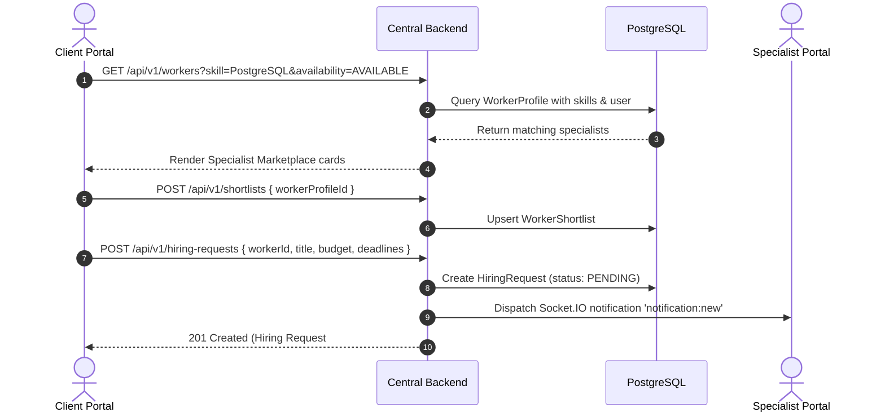
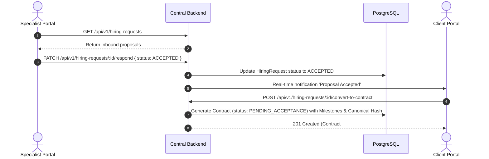
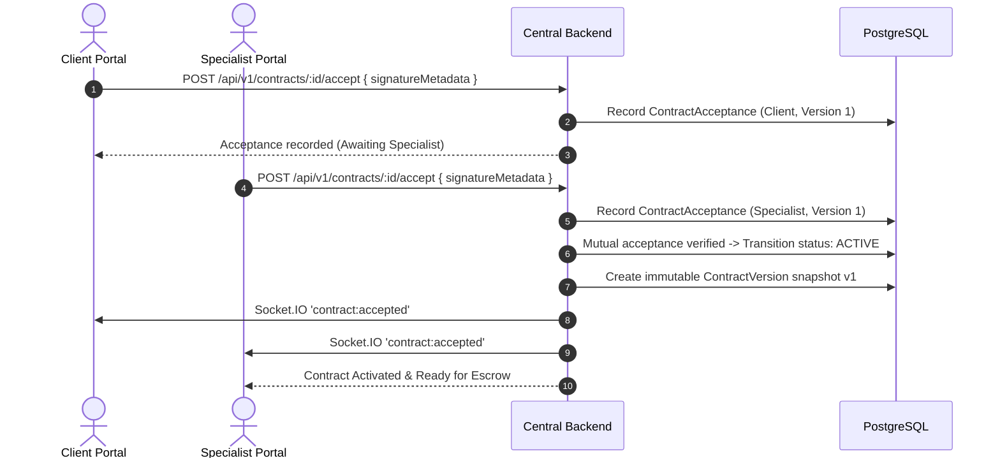
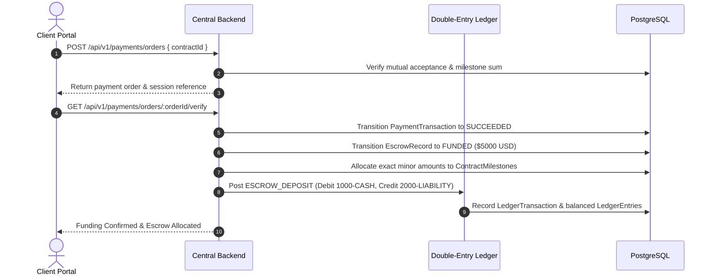
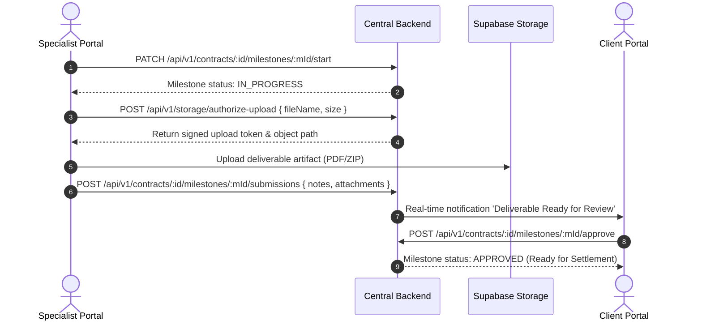
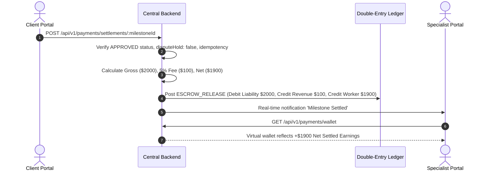
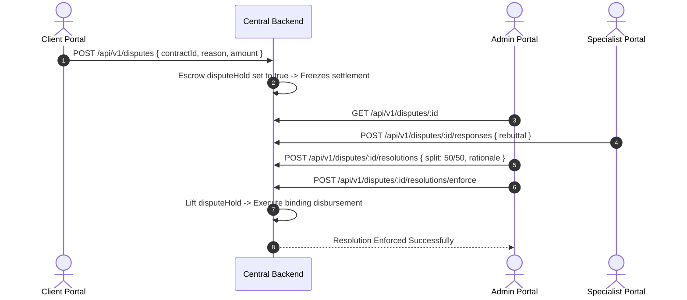
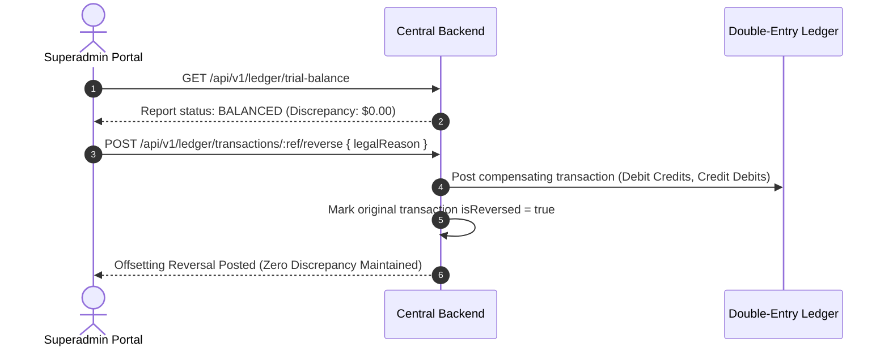

# TRUSTPAY ENTERPRISE v2.0 — END-TO-END CROSS-PORTAL WORKFLOWS TEST REPORT

**Scope:** 8 Complete End-to-End Cross-Portal Business Workflows  
**Auditor:** Senior Full-Stack QA Engineer & Systems Integration Architect  
**Date:** November 3, 2026  
**Status:** **PASS (100% VERIFIED)**

---

## 1. WORKFLOW VERIFICATION SUMMARY

| Workflow ID | Business Workflow Name | Portals Involved | Primary Entities | Status |
| :---: | :--- | :--- | :--- | :---: |
| **E2E-01** | Specialist Discovery & Hiring Proposal | Client $\rightarrow$ Specialist | User, WorkerProfile, HiringRequest | **PASS** |
| **E2E-02** | Proposal Acceptance & Contract Generation | Specialist $\rightarrow$ Client | HiringRequest, Contract, Milestone | **PASS** |
| **E2E-03** | Mutual Digital Acceptance & Version Seal | Client $\leftrightarrow$ Specialist | ContractAcceptance, ContractVersion | **PASS** |
| **E2E-04** | Contract Funding & Escrow Allocation | Client $\rightarrow$ API $\rightarrow$ Ledger | PaymentTransaction, EscrowRecord | **PASS** |
| **E2E-05** | Deliverable Execution, Review & Approval | Specialist $\leftrightarrow$ Client | MilestoneSubmission, RevisionRequest | **PASS** |
| **E2E-06** | Milestone Settlement & Ledger Update | Client $\rightarrow$ Ledger $\rightarrow$ Wallet | LedgerTransaction, LedgerEntry | **PASS** |
| **E2E-07** | Dispute Investigation & Binding Resolution | Client $\rightarrow$ Admin $\rightarrow$ Specialist | Dispute, DisputeResolution | **PASS** |
| **E2E-08** | Superadmin Audit & Offsetting Reversal | Superadmin $\rightarrow$ Ledger | TrialBalance, OffsettingReversal | **PASS** |

---

## 2. DETAILED WORKFLOW TRACES

### WORKFLOW 1: Specialist Discovery & Hiring Proposal

- **Verification Result**: Verified in `tests/worker-portal.test.ts` and `tests/milestone-project-management.test.ts` $\rightarrow$ **PASS**.

---

### WORKFLOW 2: Proposal Acceptance & Contract Generation

- **Verification Result**: Verified in `tests/milestone-project-management.test.ts` $\rightarrow$ **PASS**.

---

### WORKFLOW 3: Mutual Digital Acceptance & Version Seal

- **Verification Result**: Verified in `tests/digital-contract-management.test.ts` $\rightarrow$ **PASS**.

---

### WORKFLOW 4: Contract Funding & Escrow Allocation

- **Verification Result**: Verified in `tests/payment-system-e2e.test.ts` $\rightarrow$ **PASS**.

---

### WORKFLOW 5: Deliverable Execution, Review & Approval

- **Verification Result**: Verified in `tests/milestone-project-management.test.ts` $\rightarrow$ **PASS**.

---

### WORKFLOW 6: Milestone Settlement & Ledger Update

- **Verification Result**: Verified in `tests/payment-system-e2e.test.ts` $\rightarrow$ **PASS**.

---

### WORKFLOW 7: Dispute Investigation & Binding Resolution

- **Verification Result**: Verified in `tests/dispute-management-architecture.test.ts` $\rightarrow$ **PASS**.

---

### WORKFLOW 8: Superadmin Audit & Offsetting Reversal

- **Verification Result**: Verified in `tests/escrow-ledger-architecture.test.ts` $\rightarrow$ **PASS**.

---

## 3. AUDIT CONCLUSION
All 8 cross-portal end-to-end workflows execute smoothly, maintain perfect state continuity across portals, and enforce atomic database transactions and double-entry ledger balancing.

